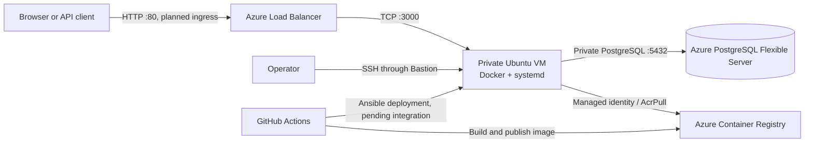

# Inventory Manager

> **Tagline:** Know your stock before you run out — simple inventory tracking for small shops in Rwanda.

## Project Overview

The Inventory Manager is an application that helps users organize products, manage stock quantities, and identify products that need restocking.

## Problem Statement

Many small retail businesses in Rwanda, such as school-supply shops, kiosks, and neighbourhood boutiques, still track their stock in paper notebooks or from memory. This makes it hard to know exactly how much of each product is left, so owners often run out of fast-selling items (for example notebooks and pens at the start of a school term) without noticing in time. Running out of stock means lost sales and unhappy customers, while over-ordering ties up limited cash.

The Inventory Manager gives these shop owners a simple digital record of their products, prices in Rwandan francs (RWF), and quantities, and automatically flags products that are running low so they can restock before they run out.

## Target Users

- **Small shop owners** (school-supply shops, kiosks, boutiques) who need an easy way to see what is in stock and what needs restocking.
- **Shop attendants** who record new products and update quantities after sales or deliveries.
- **Small business cooperatives** that want a shared, consistent way to track stock across members in the future.

## Technology Stack

- **Language:** JavaScript
- **Runtime:** Node.js
- **Package manager:** npm
- **Database:** PostgreSQL
- **Database client:** `pg`
- **Testing:** Node.js built-in test runner (`node --test`) with `node:assert`
- **Containerization:** Docker and Docker Compose
- **Version control & collaboration:** Git, GitHub (Projects board, pull requests, branch protection)

## Architecture



The public load-balancer route is present in the local Terraform changes but
has not been applied. Until approved and applied, there is no Terraform-managed
public application URL.

## Project Objectives

- Organize product information in one place.
- Allow users to view and add products.
- Allow users to update product quantities.
- Identify products that are running low in stock.
- Prevent invalid product information from being saved.

## Main Features

### 1. View Products

Users can view the products recorded in the inventory.

### 2. Add Products

Users can add products with the required product information.

### 3. Update Stock Quantities

Users can update the quantity of an existing product.

### 4. Low-Stock Warnings

The application identifies products whose quantities fall below the low-stock threshold agreed upon by the team.

### 5. Input Validation

The application checks product information and displays clear error messages when invalid information is entered.

## Product Information

Each product contains the following fields:

- **ID:** A unique identifier for the product.
- **Name:** The name of the product.
- **Price:** The price per unit.
- **Quantity:** The number of units currently in stock.

## Minimum Requirements for Version 1

- Every product must have a unique ID.
- Product names must not be empty.
- Prices and quantities must not be negative.
- Users must be able to view and add products.
- Users must be able to update product quantities.
- The application must identify low-stock products.
- Invalid inputs must produce clear error messages.

## Product Storage

Products are stored in PostgreSQL. On an empty database, the application creates
the products table and seeds the example inventory. Product changes persist
across application and container restarts.

The HTTP API provides `GET /` to list products, `GET /products/low-stock` to
list products at or below the stock threshold, `POST /products` to add a
product, and `PATCH /products/:id/quantity` to update stock. The `/health`
endpoint reports ready only when PostgreSQL is reachable.

Set `INVENTORY_READ_ONLY=true` to reject both write endpoints with HTTP 403
before the request body is parsed or the product store is called. The default
is writable (`false`) for local development. Terraform cloud-init sets the
variable for a newly provisioned VM; changing cloud-init does not update an
existing VM because Terraform ignores changes to `custom_data`.

Create a product with `POST /products` and a JSON body containing `name`,
`price`, and `quantity`. Update its stock with
`PATCH /products/<id>/quantity` and a JSON body containing `quantity`.

## Acceptance Criteria

- Users can view and add products.
- Each product follows the agreed structure.
- Product IDs are unique.
- Invalid product information is rejected with a clear error message.
- Users can update product quantities.
- Low-stock products are identified using the agreed threshold.
- The core features are tested.

## Team Responsibilities

| Member | Role | Responsibilities |
| --- | --- | --- |
| **Erica Karekezi** | Team Lead | Requirements, documentation, and team coordination |
| **Benigne Uwitonze** | Developer | Application setup, product listing, and product creation |
| **Owen Ganza** | Developer & Tester | Quantity updates, low-stock warnings, and testing |

## Collaboration Workflow

Team members work on separate branches, commit their changes, and submit pull requests for review according to the repository rules.

## Testing Results

The automated tests are run with:

```bash
npm test
```

The test suite currently covers:

- Required product fields and unique product IDs.
- Adding products with unique IDs.
- Trimming extra spaces from product names.
- Rejection of empty product names.
- Rejection of negative and invalid product prices.
- Rejection of negative and decimal initial quantities.
- Successful updates to existing product quantities.
- Rejection of negative quantities.
- Rejection of non-integer quantities.
- Rejection of unknown product IDs.
- Low-stock detection for quantities below, exactly at, and above the threshold of 20.
- An inventory containing products above the low-stock threshold, which returns no low-stock products.
- Database readiness reporting, product listing and creation, quantity updates, and malformed JSON handling in the HTTP API.
- Read-only API tests verify POST and PATCH return HTTP 403 without calling
  store write methods.

Latest local test run:

- Tests run: 26
- Tests passed: 26
- Tests failed: 0
- Tests skipped: 0

## Project Setup Instructions

### Prerequisites

Before running the Inventory Manager, make sure you have:

- [Node.js](https://nodejs.org/) installed.
- npm, which is included with Node.js.
- [Docker Desktop](https://www.docker.com/products/docker-desktop/) installed and running if you want to use Docker Compose.
- Git installed if you want to clone the project repository.

### Installation

1. Clone the repository:

   ```bash
   git clone https://github.com/Kaerica/Project-foundation-and-secure-collaboration.git
   ```

2. Navigate to the project directory:

   ```bash
   cd Project-foundation-and-secure-collaboration
   ```

3. Install dependencies:

   ```bash
   npm install
   ```

### Running the Application with Node.js

The application requires a reachable PostgreSQL database. Set `PGHOST`,
`PGPORT`, `PGUSER`, `PGPASSWORD`, and `PGDATABASE` in the environment (and set
`PGSSL=true` for a TLS-enabled database), then start it with:

```bash
npm start
```

The server initializes the products table and seeds sample products if the
database is empty.

### Running Tests

Run the automated test suite with:

```bash
npm test
```

The tests check product information, unique product IDs, product creation, quantity updates, validation, and low-stock functionality.
To check a configured PostgreSQL database directly, run `npm run test:database`
with the `PG*` connection variables set. CI runs this check against a temporary
PostgreSQL service.

### Running with Docker Compose

Docker Desktop must be installed and running before using Docker Compose.

Docker Compose starts the app and a local PostgreSQL database. Copy the
development environment example before starting:

```bash
cp .env.example .env
```

On Windows PowerShell, use:

```powershell
Copy-Item .env.example .env
```

Validate the Compose configuration and start both services:

```bash
docker compose config
docker compose up --build --detach
```

The application is available at `http://localhost:3000`. The health endpoint
is:

`http://localhost:3000/health` returns `{"status":"ok"}` when the app can reach
PostgreSQL. Check the actual database connection and seeded products with:

```powershell
docker compose exec inventory-manager node scripts/check-database.js
```

PostgreSQL data persists in the `postgres-data` Docker volume when containers
are stopped or recreated. `docker compose down -v` also deletes that data.

Stop and remove the Compose container and network:

```bash
docker compose down
```

The `.dockerignore` file prevents unnecessary files such as `node_modules`, Git metadata, logs, local environment files, and test coverage from being sent to the Docker build context.

### Troubleshooting

- If `npm` is not recognized, check that Node.js is installed and restart your terminal.
- If Docker commands cannot connect to the Docker API, open Docker Desktop and wait until the Docker engine is running.
- If a command fails, confirm that you are in the project directory containing `package.json`, `Dockerfile`, and `docker-compose.yml`.
- If tests fail, read the error output to identify which test needs attention.
- If the Docker build fails, check the Dockerfile and confirm that Docker Desktop is running.
- If the health check fails, confirm that port `3000` is available and run `docker compose logs inventory-manager`.

Task sheet: https://docs.google.com/spreadsheets/d/1TCxL-WfICCbLBdjP55zqJglPlL9q4Nc1i03C_sfZfcA/edit?usp=sharing

## Continuous Integration

GitHub Actions automatically checks code changes by running linting,
automated tests, and a Docker image build.

### Security Scanning (DevSecOps)

Every push to a non-main branch and every pull request targeting `main` runs
three security scans:

- **Dependency scanning:** `npm audit` fails on HIGH or CRITICAL advisories.
- **Container image scanning:** Trivy fails on fixable HIGH or CRITICAL vulnerabilities.
- **IaC scanning:** Checkov scans the Terraform, the Dockerfile and the CI workflow.

See [SECURITY.md](SECURITY.md) for the findings, how they were fixed, and the risks the team has accepted.

## Continuous Deployment

GitHub Actions deploys a merged `main` branch through
[`.github/workflows/cd.yml`](.github/workflows/cd.yml). The workflow builds the
image, pushes the Git SHA tag to Azure Container Registry,
opens Azure Bastion, and runs the Ansible playbook over a local SSH tunnel.
The Git SHA identifies the build commit, but SHA tags are not automatically
immutable. Registry-level immutability requires separate ACR configuration.

Ansible updates `/etc/inventory-manager.env` on the private application VM and
compares the desired image ID with the running container ID. It restarts
`inventory-manager` only when the deployment environment, image ID, or systemd
service state requires it. The VM pulls images through its managed identity and
AcrPull role; registry administrator credentials are not stored on the VM.

The deployment requires the Azure and Bastion secrets documented in
[`ansible/README.md`](ansible/README.md).

Deployment is not yet demonstrated end-to-end. The repository's current
Ansible playbook updates the image tag environment file, but the manually
configured production startup wrapper must also read that file for SHA-tagged
deployments to change the running image. The GitHub Actions deployment also
requires populated repository secrets and a Bastion SKU/configuration that
supports native client tunnelling. Do not treat the workflow as production
verified until those prerequisites are resolved and a deployment is tested.

The application image currently deployed to the existing VM was previously
verified in read-only mode. The local source and Terraform changes in this
worktree are not yet merged or deployed.

## AI Use

For the health endpoint and container checks in commit `d476b02`:

- **Prompt topic:** Assistance with adding an HTTP health endpoint and
  container checks.
- **AI outputs:** Suggestions for the `/health` endpoint, Docker and Compose
  configuration, and a health-endpoint test.
- **Files affected:** `index.js`, `products.test.js`, `Dockerfile`,
  `docker-compose.yml`, `.env.example`, and this README.
- **Team modifications:** The team reviewed, adapted, and finalized the
  suggestions.
- **Verification:** The team ran the tests and checked the container health
  endpoint.
